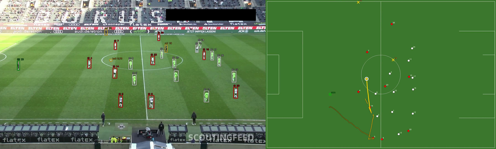
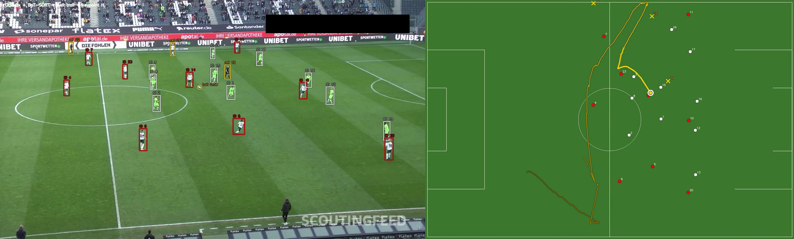

# Broadcast camera to a 2D pitch

One tactical camera in. Tracked players, the goalkeeper, the referee, and the ball on a FIFA pitch (105 × 68 m).

The demo clip is [`outputs/08fd33_yolov26x_h264.mp4`](outputs/08fd33_yolov26x_h264.mp4): the broadcast view beside the 2D pitch. The detector is YOLOv26x (`ball`, `goalkeeper`, `player`, `referee`), trained at input size 1280. Tracking is BoT-SORT. The pitch mapping comes from 32 landmarks and a homography into metres. The ball is a second low-confidence pass, kept only when the box is small, on the grass, inside the pitch, and near the previous ball.

Left: tracked boxes on the broadcast. Right: the same frame on a 105 × 68 m pitch. White and red are the two teams, green is the goalkeeper, yellow crosses are referees, and the yellow disc is the ball.





## Run

```bash
python -m venv .venv
source .venv/bin/activate
pip install -e .
python run.py \
  --video 08fd33_0.mp4 \
  --weights "yolov26x/best.pt" \
  --out outputs/08fd33_yolov26x.mp4 \
  --imgsz 1280 \
  --max-frames 750
```

The YOLOv26x weights are not in this repo. GitHub rejects files over 100 MB, and `best.pt` is 113 MB. Place the checkpoint at `yolov26x/best.pt`. The pitch-keypoint weights go in `weights/`.
